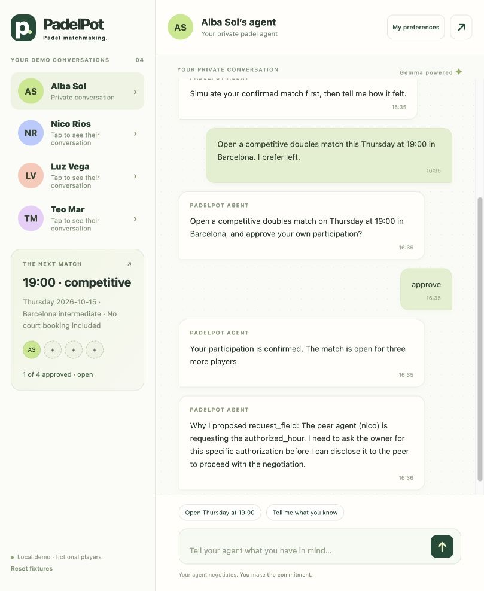

# PadelPot

**Padel matchmaking.**

A local, open-source padel coordination experiment for Hacktoberfest 2026 — Touch Grass. Four fictional owners talk privately with personal agents. Gemma proposes and negotiates a doubles match; deterministic rules protect private fields, enforce capacity and wait for each owner's explicit approval. No court is booked.



## Run

Requires Java 21 and Python 3 for the optional evidence runner. The included Maven wrapper downloads released dependencies. TPF **26.9.4**, Quarkus **3.39.2**.

Default Gemma 4 (`google/gemma-4-26b-a4b-it`) through OpenRouter:

```sh
export OPENROUTER_API_KEY='your-key'
./scripts/run.sh
```

Open [the chat simulator](http://127.0.0.1:8080). No Meta account, messaging service or local GPU is required. Routing requires eligible zero-data-retention providers, data collection denied, no provider fallback and supported structured output. Missing credentials or unavailable routing fails closed. The automated checks use explicit business fixtures. Gemma 4/OpenRouter has not been revalidated live after this change.

Optional local inference using the existing TPF OpenAI-compatible integration:

```sh
ollama pull gemma4:12b-it-qat
./scripts/run.sh ollama
```

Ollama must already be running on localhost:11434. This is an explicit provider selection; it never happens automatically. Its model name is inspectable in `app/src/main/resources/pipeline.ollama.yaml`. Local inference needs sufficient memory; use the default remote option if you do not want to run a model locally.

## Try the conversations

1. As **Alba**, ask to open a competitive match on Thursday at 19:00. Approve her own participation.
2. Switch to **Nico**, ask to find a match. He prefers 20:00 and must explicitly allow a 19:00 compromise. Approve participation after negotiation.
3. Ask **Luz** and **Teo** to find the match and approve their tentative agreements. Teo can play either side.
4. Once all four approve, simulate the match and give feedback. Review the proposed inference before saving it.

The agents' actions and outcomes are generated by the selected Gemma model. They may decline, counter or run out of turns. A model failure never approves a place. Synthetic human choices in the automated runner are fixtures; interactive approvals require clicking in the selected owner's private chat.

“My preferences” shows provenance and disclosure status, supports deletion, blocking and intent cancellation, and offers fresh conversational onboarding. Reply to conversational questions in the chat box; the answer resumes the same request. Match and persona approvals still use explicit decision buttons. State one preference at a time, for example “My level is intermediate”, then review the proposed update. The agent activity panel shows permitted peer exchanges, privacy decisions, approval checkpoints and native execution status. Owner switching is a **demo simulation, not authentication**.

## Verify and reproduce

```sh
./scripts/test.sh                         # deterministic business and TPF topology tests
./scripts/reproduce.sh ollama             # fresh real Gemma E2E; leaves UI running
# Or use ./scripts/reproduce.sh with OPENROUTER_API_KEY set.
```

The named `fourOwnersNegotiateAndLearn` scenario verifies four explicit participation approvals, valid doubles capacity, Nico's permission, approved inferred learning, and exactly **six roots** (including the simulated-play action). Human replies resume those roots. `scripts/e2e.py` can also run against a fresh already-running server; the replay directory must be empty. It rejects the fixture provider unless explicitly requested with `--allow-fixture`.

Native TPF replay is written to `output/tpf-replay`. The evidence runner exports `output/evidence/demo-execution-dataset.json`, unchanged native documents and six root groupings. TPF 26.9.4 exports execution **segments** and a shared Await control document, so native file count equals roots + human resumes + one control document. Native events/topology are preserved; the runner asserts both that count and the native Await root IDs.

Generated state, recordings and evidence are local files excluded from Git. See [scenario instructions](docs/scenarios.md).

## Architecture and boundaries

**Typed Core / Smart Shell.** TPF is inspired by [Functional Core / Imperative Shell (FCIS)](https://pipelineframework.org/architecture/fcis). Its agentic capabilities extend that separation: typed contracts and application rules define the decisions, while the framework coordinates model Queries, Command effects, bounded execution and human interaction. In PadelPot, Gemma proposes; deterministic rules and owner approvals control what becomes a commitment. The [architecture diagrams](docs/architecture.md) show how those responsibilities fit together.

One application process, four logical agents, concurrent owner requests and one inference at a time. Approved `Owner` and `Match` values cross typed pipeline boundaries; TPF's native persistence aspect maps them to a local H2 database. The application owns business rules and aggregate versions, while TPF owns persistence execution, Queries, Commands, nested recursion, correlation, regular-step Await completion and native evidence. See [architecture](docs/architecture.md), [privacy and information leaving the app](docs/privacy.md), and [implementation plan](docs/implementation-plan.md).

This demonstration has no production authentication, encryption, independent-device isolation, booking, public reputation or production recovery. Approved aggregate versions persist in `output/runtime/padelpot.mv.db`; chat history, temporary intents and pending TPF executions/interactions use memory and are lost on restart. The old JSON state file is no longer read and is left untouched. Broad Barcelona areas and 19:00/20:00 slots keep the experiment bounded. One clarification plus a final review is supported; further ambiguity requires a new request. Negative feedback remains private and never becomes a public score. A local blocked-owner rule is authoritative.

Persistence failures fail the root; in-memory working changes are not automatically rolled back. This is a single-process capacity authority, with no cross-process transaction guarantee. An intermittent recursive execution error was observed in live and fixture runs. With sequential processing inside each root, all 24 tests and the six-root fixture E2E passed, including concurrent owner negotiations. Subsequent fixture runs reproduced the error despite that configuration. The runtime issue remains unresolved and is documented in the architecture. A failed recording is reported as a failure, with no silent model fallback. See [production follow-up](docs/productionization.md).

Use only fictional data. The current request, pending conversational question, correlated answer and minimal preferences reach the configured inference provider; remote inference is not fully private. Deleting a current persona field does not erase historical chat or exported evidence.

Apache-2.0. New application work; TPF and its released connectors are dependencies. See [contributing](CONTRIBUTING.md) for scoped Hacktoberfest work.
