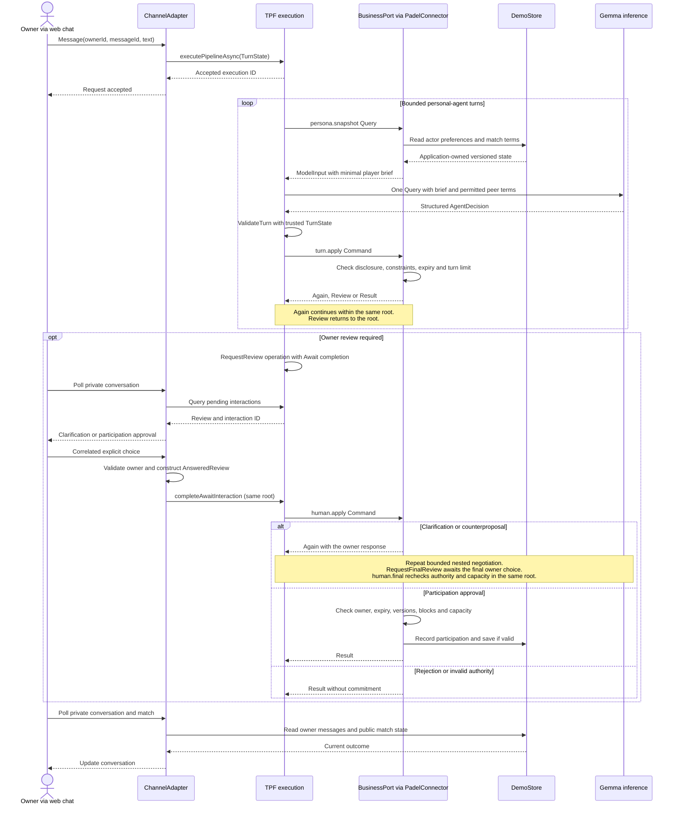
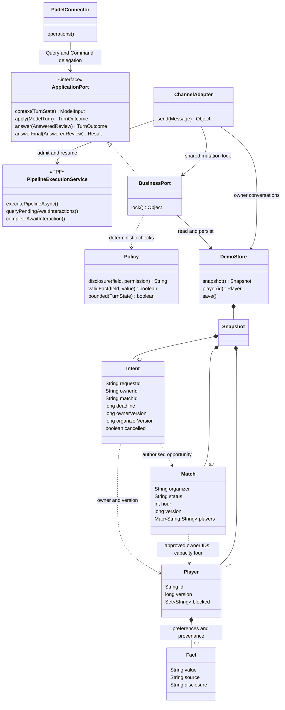

# How PadelPot uses TPF

## From FCIS to Typed Core / Smart Shell

TPF is inspired by [Functional Core / Imperative Shell (FCIS)](https://pipelineframework.org/architecture/fcis): business decisions have explicit inputs and outputs, and the surrounding shell connects them to external systems. Its [agentic capabilities](https://pipelineframework.org/value/ai-and-agentic-applications) extend that separation into **Typed Core / Smart Shell**. Model judgement can contribute a typed proposal within a flow whose contracts, authority boundaries and completion conditions remain explicit.

In PadelPot, the **typed core** includes generated domain contracts, validation and deterministic privacy, eligibility and participation rules. Gemma returns an `AgentDecision`; it cannot author trusted execution state or approve a human commitment. The **smart shell** coordinates model Queries, application Commands, nested execution, correlated owner responses and replay evidence. Application connectors own access to persona and match state; the framework manages the execution around those boundaries.

## Negotiation and human approval

The web chat is a channel adapter for a real local application. Every owner message uses an envelope with owner ID, message ID, text and, when replying, interaction ID and explicit decision. Future WhatsApp/Signal/email adapters would implement that same envelope and delivery contract. None is implemented here.

`pipeline.yaml` and its generated canonical domain contracts own execution. A new message admits one queue-async root. A nested `personal-agent` pipeline loads a versioned minimal actor snapshot through an application Query, makes one Gemma Query, validates the inert decision, and dispatches an application Command. The Command returns a typed continuation, owner review or final result. The existing self-recursive nested invocation advances to the next agent; it does not call PipelineExecutionService or create an extra root.

The model sees an explicit structured-output schema and inspectable instructions. TPF's completion envelope copies trusted state from input after validating the decision. Actor IDs, request IDs, versions, expiry and transcript are carried by the framework, not supplied by the model. There is no tool executor in the inference provider. Application code applies only the permitted structured action.

An owner review returns to the root. A regular `RequestReview` operation returns its immediate Review request; its `await:` modifier changes completion to an AnsweredReview after the interaction-api adapter admits a correlated owner response. The channel adapter validates the owner and combines the stored review with the answer before native completion; this avoids a released request-aware projector transport/domain mismatch. Privacy and participation authority are checked again by the subsequent Command. There is no Await step type. The release's inability to suspend a nested definition is accommodated by two explicit root completion checkpoints: clarification/review, then final review after clarified negotiation.

The sequence below follows a candidate's match request. Each model turn acts for one player; permitted terms pass to the next agent through trusted state. A clarification resumes negotiation before a second owner checkpoint. An agreeable proposal can go directly to participation approval.

## Application classes and state ownership

The organizer's match aggregate is the single authoritative capacity record. The application port serializes its local mutations and atomically persists its JSON snapshot. Persona state is application-owned and survives restart. TPF's memory providers own pending execution, Await interaction and Command effect state while the process is alive. We do not claim recovery of those pending roots after restart. Native Query capture, Command duplicate handling and correlated completion provide their respective execution guarantees; these are different authorities.

This class diagram selects the boundary classes and persisted business state. `Snapshot`, `Player`, `Fact`, `Match` and `Intent` are nested classes in `DemoStore`. A persona is represented by a versioned `Player` and its facts; confirmed participation is stored in `Match.players`, keyed by owner ID with the agreed court side. The contracts module supplies `ApplicationPort`, `PadelConnector` and generated domain types; the app module supplies the runtime implementation.

## Execution evidence and dependencies

The declared final E2E budget is five roots: one open request, three find requests, and one post-match feedback request. Owner clarifications, four participation approvals and the learning approval are resumes. Native file replay documents and their original topology/lifecycle events are authoritative execution evidence. The Demo Execution Dataset references those documents and includes permitted business events and public match outcome. It never manufactures a substitute TPF trace.

All TPF dependencies are pinned to 26.9.4, with matching source examined at `v26.9.4` in the upstream framework repository. Quarkus is pinned to 3.39.2. Domain, protobuf and transport adapters are generated with the released PipelineProtoGenerator, PipelineJavaDomainGenerator and annotation processor. Committed IDL files stabilize wire identities. The contracts Maven module is a compile-time library; the app is the only runtime process.

## Observed execution limitation

One live privacy run failed on recursive descent with “Recursive pipeline invocation adapter does not belong to the active parent invocation”. No private value or candidate commitment escaped. The same scenario completed after a process restart. Inspection of the available 26.10.1-SNAPSHOT runtime found the same parent-context guard; switching versions was not demonstrated to fix it, so the demo retains 26.9.4. This is an unresolved intermittent execution failure, not a privacy-policy bypass. The runner treats it as a failed recording, preserves diagnostics, and never silently retries inference or replaces it with fixture dialogue. No framework files were changed.
