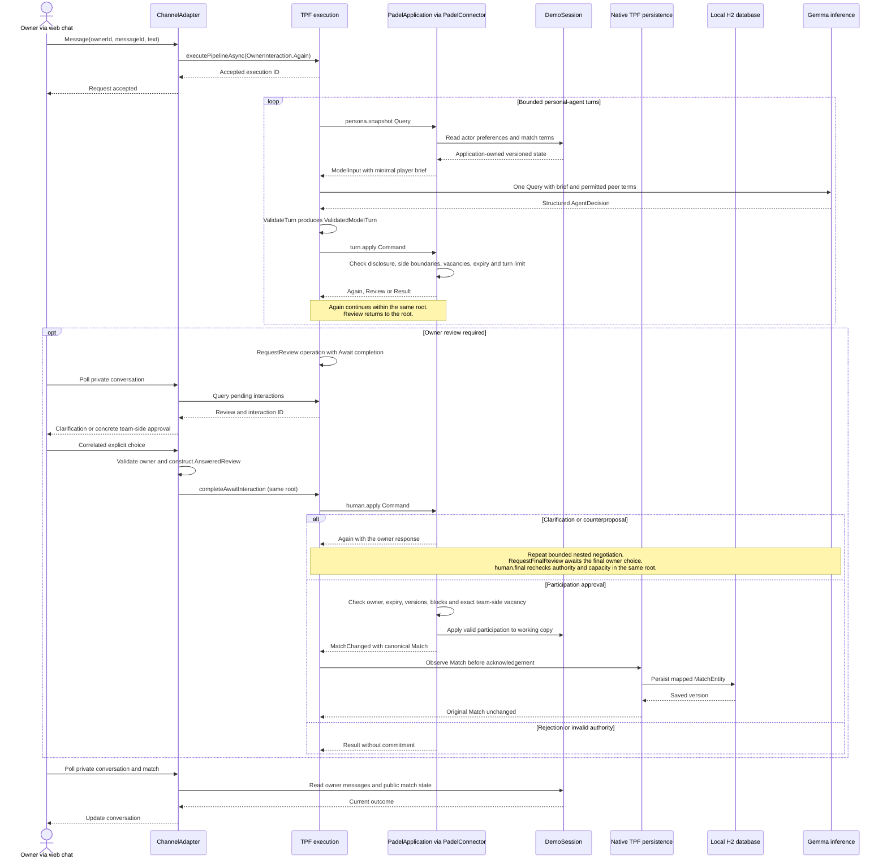
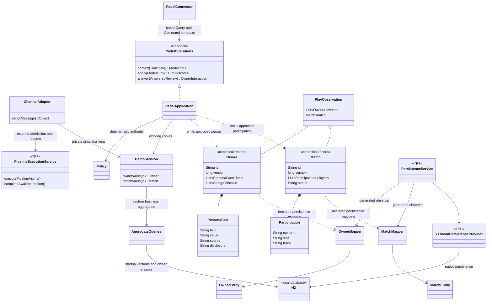

# How PadelPot uses TPF

## From FCIS to Typed Core / Smart Shell

TPF is inspired by [Functional Core / Imperative Shell (FCIS)](https://pipelineframework.org/architecture/fcis): business decisions have explicit inputs and outputs, and the surrounding shell connects them to external systems. Its [agentic capabilities](https://pipelineframework.org/value/ai-and-agentic-applications) extend that separation into **Typed Core / Smart Shell**. Model judgement can contribute a typed proposal within a flow whose contracts, authority boundaries and completion conditions remain explicit.

In PadelPot, the **typed core** includes generated domain contracts, validation and deterministic privacy, eligibility and participation rules. Gemma returns an `AgentDecision`; it cannot author trusted execution state or approve a human commitment. The **smart shell** coordinates model Queries, application Commands, nested execution, correlated owner responses and replay evidence. Application connectors enforce business authority and emit canonical aggregate values; native TPF persistence observes those values through declared representation mappings.

## Negotiation and human approval

The web chat is a channel adapter for a real local application. Every owner message uses an envelope with owner ID, message ID, text and, when replying, interaction ID and explicit decision. Future WhatsApp/Signal/email adapters would implement that same envelope and delivery contract. None is implemented here.

`pipeline.yaml` and its generated canonical domain contracts own execution. A new message admits one queue-async root. A nested `personal-agent` pipeline loads a versioned minimal actor snapshot through an application Query, makes one Gemma Query, validates the inert decision, and dispatches an application Command. The Command returns a typed continuation, owner review or final result. The existing self-recursive nested invocation advances to the next agent; it does not call PipelineExecutionService or create an extra root.

The model sees an explicit structured-output schema and inspectable instructions. TPF's completion envelope copies trusted state from input after validating the decision. Actor IDs, request IDs, versions, expiry and transcript are carried by the framework, not supplied by the model. There is no tool executor in the inference provider. Application code applies only the permitted structured action.

Conversational `message` and `ask_owner` actions in chat return a `conversation` review instead of finishing the request. The regular review operation suspends through Await. The composer sends the answer with that interaction ID and a `clarify` choice; the resumed state carries the original request, private question and answer, preserving expiry and persona version. This is bounded request context, not long-lived memory. A conversation answer cannot approve participation or a persona update. One conversational answer can precede the final approval checkpoint; another clarification at that checkpoint requires a fresh request.

Explicit English requests to open/host a match or find/join one are checked against the model's action by `ChatGoal`. This is a narrow guard over the owner's original request, not a general language parser or a source of participation authority. A mismatched action is rejected before search or mutation; one bounded model correction may continue within the same root. A repeated mismatch ends with `INTENT_MISMATCH`. Other language remains model-interpreted. Match terms still come from the validated model proposal, and opening still awaits the owner's explicit approval. A preference attached to a match request supplies request context; it does not silently become a persona edit.

An owner review returns to the root. A regular `RequestReview` operation returns its immediate Review request; its `await:` modifier changes completion to an AnsweredReview after the interaction-api adapter admits a correlated owner response. The channel adapter validates the owner, parses explicit chat replies against the stored review, and combines the review with the answer before native completion; this avoids a released request-aware projector transport/domain mismatch. Privacy and participation authority are checked again by the subsequent Command. There is no Await step type. The release's inability to suspend a nested definition is accommodated by two explicit root completion checkpoints: clarification/review, then final review after clarified negotiation.

The sequence below follows a candidate's match request. Each model turn acts for one player; permitted terms pass to the next agent through trusted state. A clarification resumes negotiation before a second owner checkpoint. An agreeable proposal can go directly to participation approval.

## Application classes and state ownership

The application owns persona meaning, disclosure policy, aggregate versions and commitment authority. TPF owns persistence execution. Approved persona changes emit a canonical `Owner` branch; approved participation emits `Match`. The YAML configures native persistence before the matching acknowledgement operations, using `mappings.persistence` to adapt canonical records to typed JPA representations. Generated persistence observers invoke TPF's released `PersistenceService` and `VThreadPersistenceProvider`. No business step calls a save method, and no application JSON writer or custom persistence provider remains.

`DemoSession` holds mutable working copies, a bounded chat view/event history and temporary intents in one process. The application owns `ApprovedTurnEntity` in H2. The declared persistence aspect observes accepted owner input before the first nested Query, the first policy-approved `Review` before Await, and a terminal `Result` before publication. It never stores an untrusted `AgentDecision` as an approved turn. Stable event IDs make repeated observation idempotent under the configured duplicate-key policy. The `persona.snapshot` Query reads the newest 100 tenant/owner-scoped earlier turns. `ConversationContextSelection` uses the portable `ContextAssembler` to prioritize recent entries, reserve room for the current owner message, omit oversized prior entries without owned references, and return selected history in chronological order. TPF captures the resulting `ModelInput` for Query replay. The assembler is pure; application storage, retention and disclosure remain PadelPot decisions. `history.erase` is a separate TPF Command with a stable command ID and an application-scoped erase operation. The fixture retains stored turns until erasure or reset. H2/JPA is blocking, so TPF offloads persistence to virtual threads; the history read and erase operations also use virtual threads. The Maven annotation processor receives the same `VThreadPersistenceProvider` class as the runtime setting, so the selected provider is checked during compilation. Short synchronized policy sections protect the organizer's capacity, uniqueness and version checks. Native admission, inference and Await completion run outside those locks. Await uses TPF's default execution-scoped identity. The removed `state.requestId` override was incorrect: 26.9.4 reads top-level field names and treated that dotted path as null, allowing reviews of the same kind to collide across roots. Concurrent requests are accepted; the provider's separate semaphore permits one model call at a time. `pipeline.parallelism=SEQUENTIAL` processes each root sequentially; independent roots still overlap. Every authored step is ONE_TO_ONE, so there is no item fan-out to parallelize. `pipeline.max-concurrency` controls item parallelism, not global root admission. `PadelOperations` is a typed application connector contract, rather than a generic port or repository.

Padel authority follows the [padel rules](padel-specs.md): four named places (A-left, A-right, B-left, B-right), and either, soft or strong court-side preferences. Trusted `TurnState` carries the concrete team and side into the approval. `Participation` preserves them in the approved match. Only candidate side preferences govern an offer, even when the organizer proposes it.

H2 runs inside the application and stores approved aggregate versions and accepted conversation turns. Each aggregate version includes the authorized change receipt (owner, request, status and message), so acknowledgement preserves the approving owner after persistence. These business receipts are never included in peer terms or model context. The JPA aggregate representation uses an immutable business ID/version identity: a delayed older write cannot overwrite a newer version. Restart queries load the greatest stored version and up to 99 recent turns per owner. Owner deletion explicitly removes that owner's stored revisions and emits the corrected `Owner` through the same native persistence boundary. The database has no encryption or production recovery claim.

TPF's memory providers own pending execution, Await interactions and Command effects while the process lives. Saved turns survive restart; temporary intents and pending roots do not. Business persistence and execution durability are separate authorities. A persistence failure fails the root, but the demo does not roll back its process-local working copies or guarantee one transaction across policy mutation and persistence. Capacity authority is limited to this one process. The UI's selected fictional owner is not authentication; deployment needs a real identity check before history read or erase.

One simulated match is one external action/root. It emits a `PlayObservation` containing four observed owners and the played match; the mapped JPA representation cascades persistence using the native provider. This small batch representation accommodates the verified 26.9.4 compiler restriction on ONE_TO_MANY inside union-routed flows. A plain ONE_TO_MANY pipeline is supported; no new TPF primitive was added.

## Execution evidence and dependencies

The declared final E2E budget is six roots: one open request, three find requests, one simulated-play action and one post-match feedback request. Owner clarifications, four participation approvals and the learning approval are resumes. Native file replay documents and their original topology/lifecycle events are authoritative execution evidence. The Demo Execution Dataset references those documents and includes permitted business events and public match outcome. It never manufactures a substitute TPF trace.

All TPF dependencies use 26.10.1-SNAPSHOT, including the published recursive parent-context fix in [runtime #44](https://github.com/The-Pipeline-Framework/pipelineframework-runtime/pull/44). Initial authoring was checked against `v26.9.4`; the snapshot upgrade was compiler-checked and exercised by the full regression suite and live Gemma flows. The exact tested runtime fingerprint is recorded in [live verification](live-verification.md). Quarkus remains pinned to 3.39.2. Domain, protobuf and transport adapters are generated with PipelineProtoGenerator, PipelineJavaDomainGenerator and the annotation processor. Committed IDL files stabilize wire identities. The contracts Maven module is a compile-time library; the app is the only runtime process.

## Recursive execution failure and published fix

TPF 26.9.4 intermittently failed on recursive descent with “Recursive pipeline invocation adapter does not belong to the active parent invocation”. Passing fixture recordings and sequential processing did not establish a fix. Real web-chat verification reproduced the failure during Teo's negotiation after three owners had approved. Teo stayed absent and the match remained open; the failed run was retained.

The published 26.10.1-SNAPSHOT runtime now includes [runtime #44](https://github.com/The-Pipeline-Framework/pipelineframework-runtime/pull/44), which restores captured parent context before executor descent instead of checking unrelated executor context first. The exact published binary was inspected before upgrading the dependency. The actual web chat then completed four approvals, including typed replies and delayed owner switching. The real Gemma API scenario completed six roots, six human replies and 13 native documents, and all 52 regression tests passed. No framework files were changed by PadelPot. These recordings establish the tested outcomes, not a production stability guarantee.
